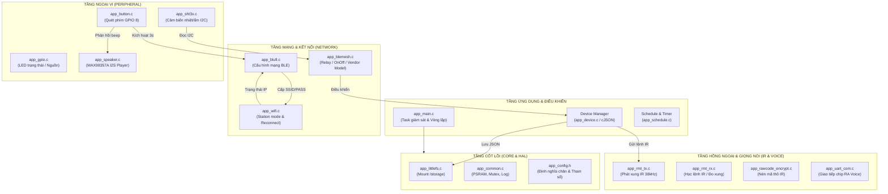
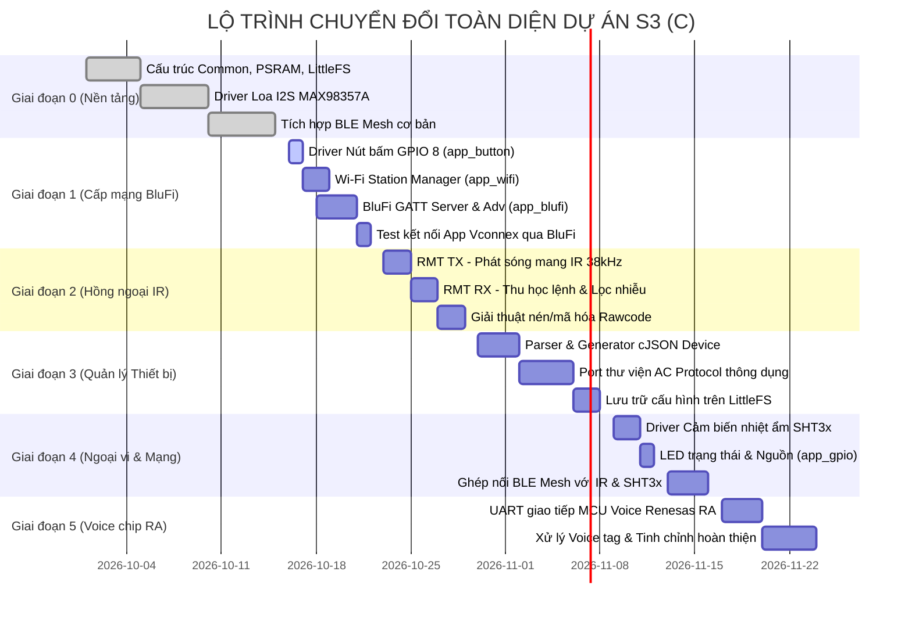
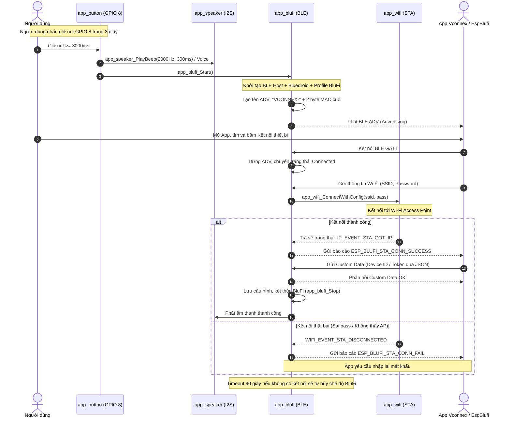
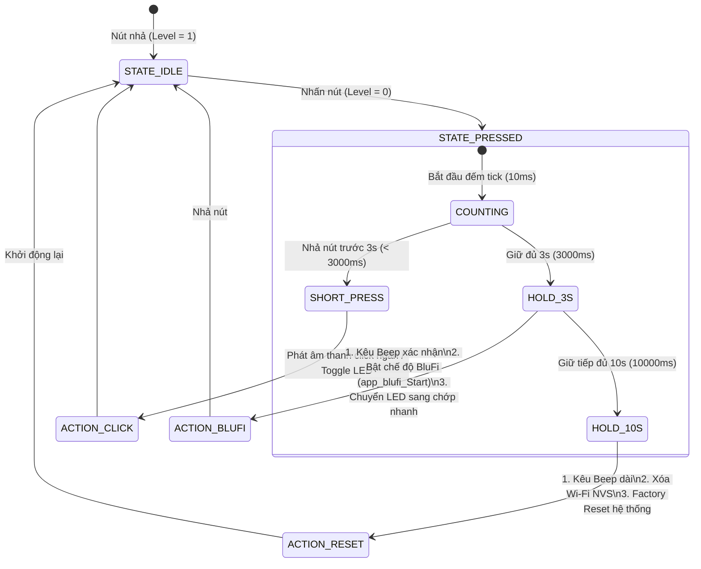
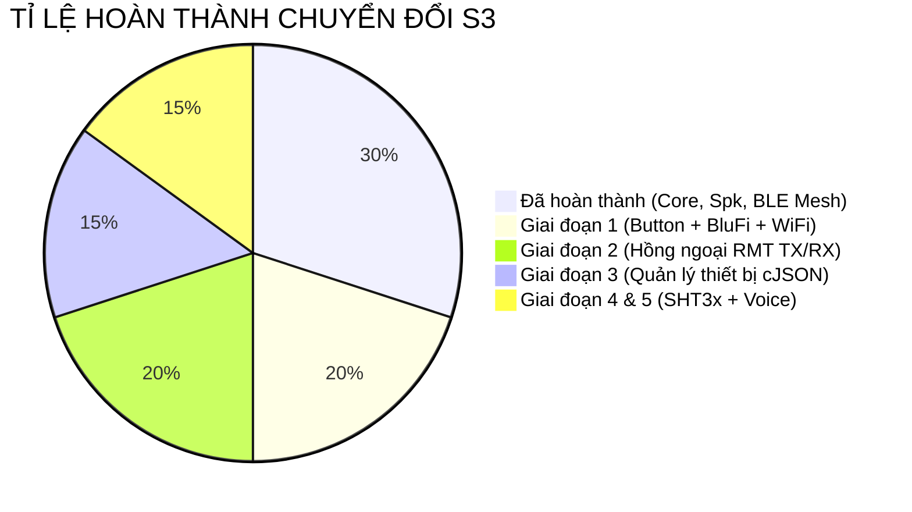

# BÁO CÁO LỘ TRÌNH CHUYỂN ĐỔI DỰ ÁN SMART IR REMOTE SANG C (ESP32-S3)

> **Dự án gốc**: `03_Smart_IR_Remote_V2_littleFS` (Viết bằng C++, ESP-IDF)  
> **Dự án đích**: `S3` (Viết bằng C thuần, ESP-IDF v5.5.5, FreeRTOS, PSRAM)  
> **Phiên bản tài liệu**: `v1.0`  
> **Ngày lập**: 16/10/2026  

---

## 1. SƠ ĐỒ KIẾN TRÚC HỆ THỐNG DỰ ÁN S3 (C ARCHITECTURE)

---

## 2. LỘ TRÌNH TỔNG THỂ 5 GIAI ĐOẠN

---

## 3. CHI TIẾT GIAI ĐOẠN 1: THÊM THIẾT BỊ VÀO APP BẰNG BLUFI KHI BẤM NÚT

### 3.1. Sơ đồ tuần tự xử lý (Sequence Flow)

---

### 3.2. Sơ đồ máy trạng thái nút nhấn (Button State Machine)

---

### 3.3. Các module cần triển khai trong Giai đoạn 1

| STT | File cần tạo / sửa | Mô tả trách nhiệm | Trạng thái |
| :---: | :--- | :--- | :---: |
| 1 | `app_config.h` | Bổ sung định nghĩa chân `BUTTON_PIN (8)`, cấu hình BluFi timeout, tên thiết bị. | Đang chờ |
| 2 | `peripheral/app_button.h` | Khai báo API: `app_button_Init()`, callback sự kiện nút. | Đang chờ |
| 3 | `peripheral/app_button.c` | Task FreeRTOS quét nút 10ms, chống rung, xử lý Short/3s/10s. | Đang chờ |
| 4 | `network/app_wifi.h` | Khai báo API: `app_wifi_Init()`, `app_wifi_Connect()`, `app_wifi_IsConnected()`. | Đang chờ |
| 5 | `network/app_wifi.c` | Khởi tạo Netif Station, quản lý event loop, tự động reconnect. | Đang chờ |
| 6 | `network/app_blufi.h` | Khai báo API: `app_blufi_Init()`, `app_blufi_Start()`, `app_blufi_Stop()`. | Đang chờ |
| 7 | `network/app_blufi.c` | Cài đặt Bluetooth GATT Server, Adv, nhận SSID/Pass & Custom JSON. | Đang chờ |
| 8 | `CMakeLists.txt` | Đăng ký các file `.c` mới và các thư viện `esp_wifi`, `esp_netif`, `bt`. | Đang chờ |
| 9 | `app_main.c` | Khởi động `app_button_Init()` và `app_wifi_Init()` trong hàm `app_main`. | Đang chờ |

---

## 4. BẢNG THEO DÕI TIẾN ĐỘ TỔNG QUAN

